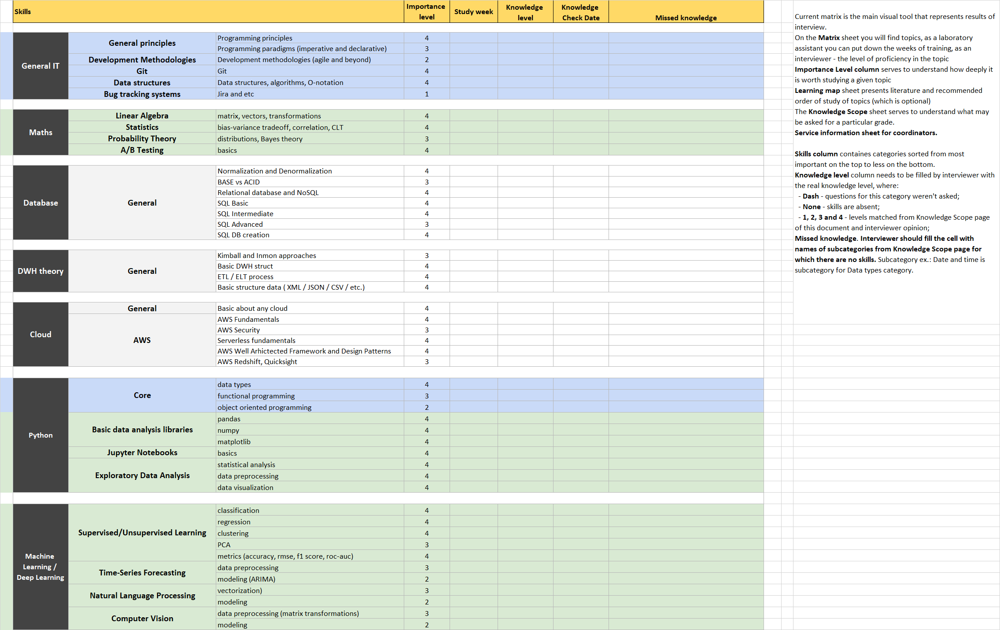
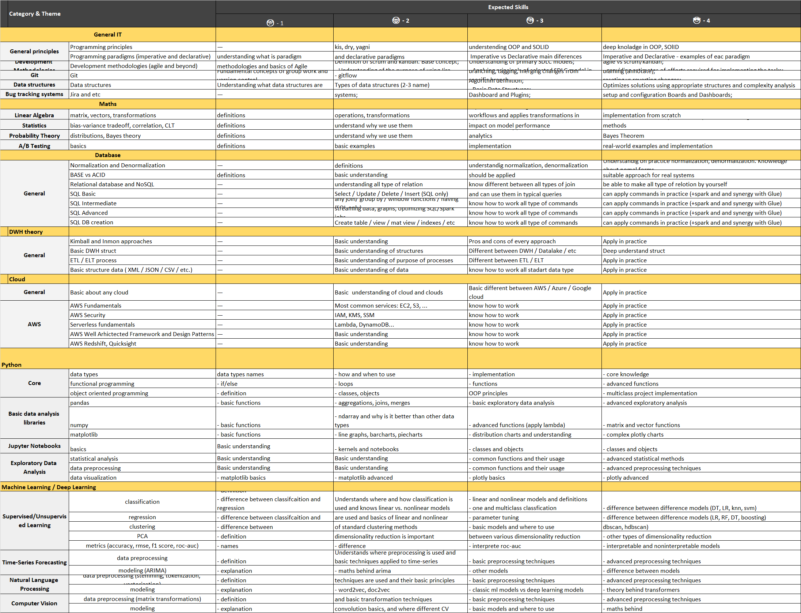

|                                                                                               |                                                                         | Certificate

| Supplement                                                                          |  |  |  |
| ----------------------------------------------------------------------------------- | - | - | - |
|  |  |  |  |
| ---                                                                                 |  |  |  |

|                                                                         |
|                                                                                               |                                                                         |
|                                                                                               |                                                                         |
|                                                                                               | Name of the
  certificate holder                                        |   |   |
|                                                                                               | Name of the
  program                                                   | Data Engineer
  /  Data Science |   |
|                                                                                               |                                                                         |   |   |   |
|                                                                                               | Certificate
  Number                                                    |   |   |
|                                                                                               |                                                                         |   |   |   |
|                                                                                               | Program elements                                                        | Grade  |
|                                                                                               |                                                                         |   |   |   |
|                                                                                               | Theory
  (1-4):                                                         |
|                                                                                               | General IT                                                              | Programming principles |  |
|                                                                                               | Programming paradigms
  (imperative and declarative)                    |  |
|                                                                                               | Development methodologies
  (agile and beyond)                          |  |
|                                                                                               | Git                                                                     |  |
|                                                                                               | Data structures,
  algorithms, O-notation                               |  |
|                                                                                               | Jira and etc                                                            |  |
|                                                                                               | Maths                                                                   | matrix, vectors, transformations |  |
|                                                                                               | bias-variance tradeoff, correlation, CLT                                |  |
|                                                                                               | distributions, Bayes theory                                             |  |
|                                                                                               | basics                                                                  |  |
|                                                                                               | Database                                                                | Normalization and
  Denormalization |  |
|                                                                                               | BASE vs ACID                                                            |  |
|                                                                                               | Relational database and
  NoSQL                                         |  |
|                                                                                               | SQL Basic                                                               |  |
|                                                                                               | SQL Intermediate                                                        |  |
|                                                                                               | SQL Advanced                                                            |  |
|                                                                                               | SQL DB creation                                                         |  |
|                                                                                               | DWH theory                                                              | Kimball and Inmon
  approaches |  |
|                                                                                               | Basic DWH struct                                                        |  |
|                                                                                               | ETL / ELT process                                                       |  |
|                                                                                               | Basic structure data ( XML
  / JSON / CSV / etc.)                       |  |
|                                                                                               | Cloud                                                                   | Basic about any cloud |  |
|                                                                                               | AWS Fundamentals                                                        |  |
|                                                                                               | AWS Security                                                            |  |
|                                                                                               | Serverless fundamentals                                                 |  |
|                                                                                               | AWS Well Arhictected
  Framework and Design Patterns                    |  |
|                                                                                               | AWS Redshift, Quicksight                                                |  |
|                                                                                               | Python                                                                  | data types |  |
|                                                                                               | functional programming                                                  |  |
|                                                                                               | object oriented programming                                  |  |
|                                                                                               | pandas                                                       |  |
|                                                                                               | numpy                                                        |  |
|                                                                                               | matplotlib                                                   |  |
|                                                                                               | basics                                                       |  |
|                                                                                               | statistical analysis                                         |  |
|                                                                                               | data preprocessing                                           |  |
|                                                                                               | data visualization                                           |  |
|                                                                                               | Machine
  Learning / Deep Learning                                      | classification |  |
|                                                                                               | regression                                                   |  |
|                                                                                               | clustering                                                   |  |
|                                                                                               | PCA                                                          |  |
|                                                                                               | metrics (accuracy, rmse, f1 score,
  roc-auc)                |  |
|                                                                                               | data preprocessing                                           |  |
|                                                                                               | modeling (ARIMA)                                             |  |
|                                                                                               | data preprocessing (stemming,
  tokenization, vectorization) |  |
|                                                                                               | modeling                                                     |  |
|                                                                                               | data preprocessing (matrix
  transformations)                |  |
|                                                                                               | modeling                                                     |  |
|                                                                                               |                                                                         |   |   |   |
|                                                                                               | Practice
  (0-30)                                                       | #DIV/0#DIV/0! |
|                                                                                               | including:                                                              |
|                                                                                               |                                                                         | Legacy
  Code | - |
|                                                                                               |                                                                         | Peer
  Programming | - |
|                                                                                               |                                                                         | PO changes
  deadlines | - |
|                                                                                               |                                                                         | Implement
  without design and analytics | - |
|                                                                                               |                                                                         | Present
  Team Work for Sprint Review | - |
|                                                                                               |                                                                         | Achieve
  the Sprint Goal | - |
|                                                                                               |                                                                         |   |   |   |
|                                                                                               | Meet
  Up                                                               | 0 | 0 |
|                                                                                               |                                                                       0 | 0 |
|                                                                                               |                                                                         |   |   |   |
|                                                                                               | Final Exam (1-10)                                                       |   |
|                                                                                               |                                                                         |   |   |   |
|                                                                                               | Run Ups
  (Average)                                                     |   |   | #DIV/0#DIV/0! |
|                                                                                               |                                                                         |   |   |   |

|              | Company Trainee Rank | #DIV/0#DIV/0! |  |  |  |  |  |  |  |  |  |  |  |  |  |  |  |  |  |  |  |  |  |  |  |  |  |  |  |  |  |  |  |  |  |  |  |  |  |  |  |  |  |  |  |  |  |  |  |  |  |  |  |  |  |  |  |  |  |  |  |  |  |  |  |  |  |  |  |  |  |  |  |  |  |  |  |  |  |  |  |  |  |  |  |  |  |  |  |  |  |  |  |  |  |  |  |  |  |  |  |  |  |  |  |  |  |  |  |  |  |  |  |  |  |  |  |  |  |  |  |  |  |  |  |  |  |  |  |  |  |  |  |  |  |  |  |  |  |  |  |  |  |  |  |  |  |  |  |  |  |  |  |  |  |  |  |  |  |  |  |  |  |  |  |  |  |  |  |  |  |  |  |  |  |  |  |  |  |  |  |  |  |  |  |  |  |  |  |  |  |  |  |  |  |  |  |  |  |  |  |  |  |  |  |  |  |  |  |  |  |  |  |  |  |  |  |  |  |  |  |  |  |  |  |  |  |  |  |  |  |  |  |  |  |  |  |  |  |  |  |  |  |  |  |  |  |  |  |  |  |  |  |  |  |  |  |  |  |  |  |  |  |  |  |  |  |  |  |  |  |  |  |  |  |  |  |  |  |  |  |  |  |  |  |  |  |  |  |  |  |  |  |  |  |  |  |  |  |  |  |  |  |  |  |  |  |  |  |  |  |  |  |  |  |  |  |  |  |  |  |  |  |  |  |  |  |  |  |  |  |  |  |  |  |
| ------------ | -------------------- | ------------- | - | - | - | - | - | - | - | - | - | - | - | - | - | - | - | - | - | - | - | - | - | - | - | - | - | - | - | - | - | - | - | - | - | - | - | - | - | - | - | - | - | - | - | - | - | - | - | - | - | - | - | - | - | - | - | - | - | - | - | - | - | - | - | - | - | - | - | - | - | - | - | - | - | - | - | - | - | - | - | - | - | - | - | - | - | - | - | - | - | - | - | - | - | - | - | - | - | - | - | - | - | - | - | - | - | - | - | - | - | - | - | - | - | - | - | - | - | - | - | - | - | - | - | - | - | - | - | - | - | - | - | - | - | - | - | - | - | - | - | - | - | - | - | - | - | - | - | - | - | - | - | - | - | - | - | - | - | - | - | - | - | - | - | - | - | - | - | - | - | - | - | - | - | - | - | - | - | - | - | - | - | - | - | - | - | - | - | - | - | - | - | - | - | - | - | - | - | - | - | - | - | - | - | - | - | - | - | - | - | - | - | - | - | - | - | - | - | - | - | - | - | - | - | - | - | - | - | - | - | - | - | - | - | - | - | - | - | - | - | - | - | - | - | - | - | - | - | - | - | - | - | - | - | - | - | - | - | - | - | - | - | - | - | - | - | - | - | - | - | - | - | - | - | - | - | - | - | - | - | - | - | - | - | - | - | - | - | - | - | - | - | - | - | - | - | - | - | - | - | - | - | - | - | - | - | - | - | - | - | - | - | - | - | - | - | - | - | - | - | - | - | - | - | - | - | - | - | - | - | - | - | - | - |
|    |                      |               |  |  |  |  |  |  |  |  |  |  |  |  |  |  |  |  |  |  |  |  |  |  |  |  |  |  |  |  |  |  |  |  |  |  |  |  |  |  |  |  |  |  |  |  |  |  |  |  |  |  |  |  |  |  |  |  |  |  |  |  |  |  |  |  |  |  |  |  |  |  |  |  |  |  |  |  |  |  |  |  |  |  |  |  |  |  |  |  |  |  |  |  |  |  |  |  |  |  |  |  |  |  |  |  |  |  |  |  |  |  |  |  |  |  |  |  |  |  |  |  |  |  |  |  |  |  |  |  |  |  |  |  |  |  |  |  |  |  |  |  |  |  |  |  |  |  |  |  |  |  |  |  |  |  |  |  |  |  |  |  |  |  |  |  |  |  |  |  |  |  |  |  |  |  |  |  |  |  |  |  |  |  |  |  |  |  |  |  |  |  |  |  |  |  |  |  |  |  |  |  |  |  |  |  |  |  |  |  |  |  |  |  |  |  |  |  |  |  |  |  |  |  |  |  |  |  |  |  |  |  |  |  |  |  |  |  |  |  |  |  |  |  |  |  |  |  |  |  |  |  |  |  |  |  |  |  |  |  |  |  |  |  |  |  |  |  |  |  |  |  |  |  |  |  |  |  |  |  |  |  |  |  |  |  |  |  |  |  |  |  |  |  |  |  |  |  |  |  |  |  |  |  |  |  |  |  |  |  |  |  |  |  |  |  |  |  |  |  |  |  |  |  |  |  |  |  |  |  |  |  |  |  |  |

|  |  |  |
| -- |

  |                                                            | Here you
  can see the recommended study plan for topics. It is optional but can provide
  an overview of the learning process.                                                                                                                                                                                                                                                                                                                                   |  | The
  literature covers a small part of the questions from the Knowledge scope page
  and serves to give you a foundation on the basis of which you can understand

| in which direction to google     |                                             |                                                                                                                                                                                                                                                                                         |                                                                                                                                                                                                                                                                                                                                                                                                                                                                     |                                                                                                                                                                                                                                                                                                                                                                                                                                                                                                                                                                                                                           |  |
| -------------------------------- | :------------------------------------------ | --------------------------------------------------------------------------------------------------------------------------------------------------------------------------------------------------------------------------------------------------------------------------------------- | :------------------------------------------------------------------------------------------------------------------------------------------------------------------------------------------------------------------------------------------------------------------------------------------------------------------------------------------------------------------------------------------------------------------------------------------------------------------ | ------------------------------------------------------------------------------------------------------------------------------------------------------------------------------------------------------------------------------------------------------------------------------------------------------------------------------------------------------------------------------------------------------------------------------------------------------------------------------------------------------------------------------------------------------------------------------------------------------------------------- | :- |
|                                  |                                             | ANDERSEN Trainee                                                                                                                                                                                                                                                                        |                                                                                                                                                                                                                                                                                                                                                                                                                                                                     |                                                                                                                                                                                                                                                                                                                                                                                                                                                                                                                                                                                                                           |  |
|                                  |                                             | Data Engineer / Data Science                                                                                                                                                                                                                                                            |                                                                                                                                                                                                                                                                                                                                                                                                                                                                     |                                                                                                                                                                                                                                                                                                                                                                                                                                                                                                                                                                                                                           |  |
|                                  |                                             |                                                                                                                                                                                                                                                                                         |                                                                                                                                                                                                                                                                                                                                                                                                                                                                     |                                                                                                                                                                                                                                                                                                                                                                                                                                                                                                                                                                                                                           |  |
|                                  |                                             |                                                                                                                                                                                                                                                                                         |                                                                                                                                                                                                                                                                                                                                                                                                                                                                     |                                                                                                                                                                                                                                                                                                                                                                                                                                                                                                                                                                                                                           |  |
|                                  | Skills                                      |                                                                                                                                                                                                                                                                                         | Literature                                                                                                                                                                                                                                                                                                                                                                                                                                                          |                                                                                                                                                                                                                                                                                                                                                                                                                                                                                                                                                                                                                           |  |
|                                  |                                             |                                                                                                                                                                                                                                                                                         |                                                                                                                                                                                                                                                                                                                                                                                                                                                                     |                                                                                                                                                                                                                                                                                                                                                                                                                                                                                                                                                                                                                           |  |
|                                  | General IT                                  |                                                                                                                                                                                                                                                                                         |                                                                                                                                                                                                                                                                                                                                                                                                                                                                     |                                                                                                                                                                                                                                                                                                                                                                                                                                                                                                                                                                                                                           |  |
|                                  | General                                     |                                                                                                                                                                                                                                                                                         |                                                                                                                                                                                                                                                                                                                                                                                                                                                                     |                                                                                                                                                                                                                                                                                                                                                                                                                                                                                                                                                                                                                           |  |
| principles                       | Programming                                 |                                                                                                                                                                                                                                                                                         |                                                                                                                                                                                                                                                                                                                                                                                                                                                                     |                                                                                                                                                                                                                                                                                                                                                                                                                                                                                                                                                                                                                           |  |
| principles                       |                                             | [https://www.studocu.com/row/document/university-of-nairobi/information-communication-technology/elementary-programming-principles/21247793](https://www.studocu.com/row/document/university-of-nairobi/information-communication-technology/elementary-programming-principles/21247793) |                                                                                                                                                                                                                                                                                                                                                                                                                                                                     |                                                                                                                                                                                                                                                                                                                                                                                                                                                                                                                                                                                                                           |  |
|                                  | Programming paradigms                       |                                                                                                                                                                                                                                                                                         |                                                                                                                                                                                                                                                                                                                                                                                                                                                                     |                                                                                                                                                                                                                                                                                                                                                                                                                                                                                                                                                                                                                           |  |
| (imperative and declarative)     |                                             | [https://www.baeldung.com/cs/imperative-vs-declarative-programming](https://www.baeldung.com/cs/imperative-vs-declarative-programming)                                                                                                                                                   |                                                                                                                                                                                                                                                                                                                                                                                                                                                                     |                                                                                                                                                                                                                                                                                                                                                                                                                                                                                                                                                                                                                           |  |
|                                  | Development                                 |                                                                                                                                                                                                                                                                                         |                                                                                                                                                                                                                                                                                                                                                                                                                                                                     |                                                                                                                                                                                                                                                                                                                                                                                                                                                                                                                                                                                                                           |  |
| Methodologies                    | Development                                 |                                                                                                                                                                                                                                                                                         |                                                                                                                                                                                                                                                                                                                                                                                                                                                                     |                                                                                                                                                                                                                                                                                                                                                                                                                                                                                                                                                                                                                           |  |
| methodologies (agile and beyond) |                                             | [https://www.atlassian.com/agile/manifesto](https://www.atlassian.com/agile/manifesto)                                                                                                                                                                                                   |                                                                                                                                                                                                                                                                                                                                                                                                                                                                     |                                                                                                                                                                                                                                                                                                                                                                                                                                                                                                                                                                                                                           |  |
|                                  | Git                                         | Git                                                                                                                                                                                                                                                                                     |                                                                                                                                                                                                                                                                                                                                                                                                                                                                     | [https://www.atlassian.com/git/tutorials/learn-git-with-bitbucket-cloud](https://www.atlassian.com/git/tutorials/learn-git-with-bitbucket-cloud)                                                                                                                                                                                                                                                                                                                                                                                                                                                                           |  |
|                                  | Data structures                             | Data structures                                                                                                                                                                                                                                                                         |                                                                                                                                                                                                                                                                                                                                                                                                                                                                     | [https://www.techtarget.com/searchdatamanagement/definition/data-structure](https://www.techtarget.com/searchdatamanagement/definition/data-structure)                                                                                                                                                                                                                                                                                                                                                                                                                                                                     |  |
|                                  | Bug tracking systems                        | Jira and etc                                                                                                                                                                                                                                                                            |                                                                                                                                                                                                                                                                                                                                                                                                                                                                     | [https://www.javatpoint.com/defect-or-bug-tracking-tool](https://www.javatpoint.com/defect-or-bug-tracking-tool)                                                                                                                                                                                                                                                                                                                                                                                                                                                                                                           |  |
|                                  | Maths                                       |                                                                                                                                                                                                                                                                                         |                                                                                                                                                                                                                                                                                                                                                                                                                                                                     |                                                                                                                                                                                                                                                                                                                                                                                                                                                                                                                                                                                                                           |  |
|                                  | Linear Algebra                              | matrix, vectors, transformations                                                                                                                                                                                                                                                        |                                                                                                                                                                                                                                                                                                                                                                                                                                                                     | [https://pub.towardsai.net/basic-linear-algebra-for-deep-learning-and-machine-learning-ml-python-tutorial-444e23db3e9e](https://pub.towardsai.net/basic-linear-algebra-for-deep-learning-and-machine-learning-ml-python-tutorial-444e23db3e9e)                                                                                                                                                                                                                                                                                                                                                                             |  |
|                                  | Statistics                                  | bias-variance tradeoff, correlation, CLT                                                                                                                                                                                                                                                |                                                                                                                                                                                                                                                                                                                                                                                                                                                                     | [https://www.simplilearn.com/tutorials/machine-learning-tutorial/statistics-for-machine-learning https://towardsdatascience.com/the-basic-essentials-statistics-for-machine-learning-dd9cfeb0e5ef](https://www.simplilearn.com/tutorials/machine-learning-tutorial/statistics-for-machine-learning)                                                                                                                                                                                                                                                                                                                        |  |
|                                  | Probability Theory                          | distributions, Bayes theory                                                                                                                                                                                                                                                             |                                                                                                                                                                                                                                                                                                                                                                                                                                                                     | [https://towardsdatascience.com/probability-fundamentals-of-machine-learning-part-1-a156b4703e69#:~:text=Fundamentals%20of%20Machine%20Learning%20(Part%201)&amp;text=Probability%20theory%20is%20a%20mathematical,of%20many%20machine%20learning%20algorithms. https://www.analyticsvidhya.com/blog/2021/04/probability-theory-basics-in-machine-learning/](<https://towardsdatascience.com/probability-fundamentals-of-machine-learning-part-1-a156b4703e69#:~:text=Fundamentals%20of%20Machine%20Learning%20(Part%201)&text=Probability%20theory%20is%20a%20mathematical,of%20many%20machine%20learning%20algorithms.>) |  |
|                                  | A/B Testing                                 | basics                                                                                                                                                                                                                                                                                  |                                                                                                                                                                                                                                                                                                                                                                                                                                                                     | [https://towardsdatascience.com/a-b-testing-the-basics-86d6d98525c9](https://towardsdatascience.com/a-b-testing-the-basics-86d6d98525c9)                                                                                                                                                                                                                                                                                                                                                                                                                                                                                   |  |
|                                  | Database                                    |                                                                                                                                                                                                                                                                                         |                                                                                                                                                                                                                                                                                                                                                                                                                                                                     |                                                                                                                                                                                                                                                                                                                                                                                                                                                                                                                                                                                                                           |  |
|                                  | General                                     | Normalization and                                                                                                                                                                                                                                                                       |                                                                                                                                                                                                                                                                                                                                                                                                                                                                     |                                                                                                                                                                                                                                                                                                                                                                                                                                                                                                                                                                                                                           |  |
| Denormalization                  |                                             | [https://builtin.com/big-data/denormalization](https://builtin.com/big-data/denormalization)                                                                                                                                                                                             |                                                                                                                                                                                                                                                                                                                                                                                                                                                                     |                                                                                                                                                                                                                                                                                                                                                                                                                                                                                                                                                                                                                           |  |
|                                  | BASE vs ACID                                |                                                                                                                                                                                                                                                                                         | [https://www.geeksforgeeks.org/acid-model-vs-base-model-for-database/](https://www.geeksforgeeks.org/acid-model-vs-base-model-for-database/)                                                                                                                                                                                                                                                                                                                         |                                                                                                                                                                                                                                                                                                                                                                                                                                                                                                                                                                                                                           |  |
|                                  | Relational database                         |                                                                                                                                                                                                                                                                                         |                                                                                                                                                                                                                                                                                                                                                                                                                                                                     |                                                                                                                                                                                                                                                                                                                                                                                                                                                                                                                                                                                                                           |  |
| and NoSQL                        |                                             | [https://habr.com/ru/articles/152477/](https://habr.com/ru/articles/152477/)                                                                                                                                                                                                             |                                                                                                                                                                                                                                                                                                                                                                                                                                                                     |                                                                                                                                                                                                                                                                                                                                                                                                                                                                                                                                                                                                                           |  |
|                                  | SQL Basic                                   |                                                                                                                                                                                                                                                                                         | [https://drive.google.com/file/d/1Jkz8aJlhiMuReW3jjbMRCmtV66iT7-xO/view?usp=sharing](https://drive.google.com/file/d/1Jkz8aJlhiMuReW3jjbMRCmtV66iT7-xO/view?usp=sharing)                                                                                                                                                                                                                                                                                             |                                                                                                                                                                                                                                                                                                                                                                                                                                                                                                                                                                                                                           |  |
|                                  | SQL Intermediate                            |                                                                                                                                                                                                                                                                                         | [https://drive.google.com/file/d/1Jkz8aJlhiMuReW3jjbMRCmtV66iT7-xO/view?usp=sharing](https://drive.google.com/file/d/1Jkz8aJlhiMuReW3jjbMRCmtV66iT7-xO/view?usp=sharing)                                                                                                                                                                                                                                                                                             |                                                                                                                                                                                                                                                                                                                                                                                                                                                                                                                                                                                                                           |  |
|                                  | SQL Advanced                                |                                                                                                                                                                                                                                                                                         | [https://spark.apache.org/docs/latest/structured-streaming-programming-guide.html](https://spark.apache.org/docs/latest/structured-streaming-programming-guide.html)                                                                                                                                                                                                                                                                                                 |                                                                                                                                                                                                                                                                                                                                                                                                                                                                                                                                                                                                                           |  |
|                                  | SQL DB creation                             |                                                                                                                                                                                                                                                                                         | [https://cloud.google.com/bigquery/docs/tables    https://cloud.google.com/bigquery/docs/views    https://cloud.google.com/bigquery/docs/materialized-views-create    https://planetscale.com/blog/how-do-database-indexes-work    https://www.oracletutorial.com/oracle-index/oracle-create-index/](https://cloud.google.com/bigquery/docs/tables)                                                                                                                  |                                                                                                                                                                                                                                                                                                                                                                                                                                                                                                                                                                                                                           |  |
|                                  | DWH theory                                  |                                                                                                                                                                                                                                                                                         |                                                                                                                                                                                                                                                                                                                                                                                                                                                                     |                                                                                                                                                                                                                                                                                                                                                                                                                                                                                                                                                                                                                           |  |
|                                  | General                                     | Kimball and Inmon                                                                                                                                                                                                                                                                       |                                                                                                                                                                                                                                                                                                                                                                                                                                                                     |                                                                                                                                                                                                                                                                                                                                                                                                                                                                                                                                                                                                                           |  |
| approaches                       |                                             | [https://www.geeksforgeeks.org/difference-between-kimball-and-inmon/](https://www.geeksforgeeks.org/difference-between-kimball-and-inmon/)                                                                                                                                               |                                                                                                                                                                                                                                                                                                                                                                                                                                                                     |                                                                                                                                                                                                                                                                                                                                                                                                                                                                                                                                                                                                                           |  |
|                                  | Basic DWH struct                            |                                                                                                                                                                                                                                                                                         | [https://en.wikipedia.org/wiki/Data_warehouse    https://en.wikipedia.org/wiki/Data_lake](https://en.wikipedia.org/wiki/Data_warehouse)                                                                                                                                                                                                                                                                                                                              |                                                                                                                                                                                                                                                                                                                                                                                                                                                                                                                                                                                                                           |  |
|                                  | ETL / ELT process                           |                                                                                                                                                                                                                                                                                         | [https://habr.com/ru/articles/695546/https://www.integrate.io/blog/etl-vs-elt/](https://habr.com/ru/articles/695546/)                                                                                                                                                                                                                                                                                                                                                |                                                                                                                                                                                                                                                                                                                                                                                                                                                                                                                                                                                                                           |  |
|                                  | Basic structure data                        |                                                                                                                                                                                                                                                                                         |                                                                                                                                                                                                                                                                                                                                                                                                                                                                     |                                                                                                                                                                                                                                                                                                                                                                                                                                                                                                                                                                                                                           |  |
| ( XML / JSON / CSV / etc.)       |                                             | [https://en.wikipedia.org/wiki/JSON    https://en.wikipedia.org/wiki/XML    https://en.wikipedia.org/wiki/Comma-separated_values](https://en.wikipedia.org/wiki/JSON)                                                                                                                    |                                                                                                                                                                                                                                                                                                                                                                                                                                                                     |                                                                                                                                                                                                                                                                                                                                                                                                                                                                                                                                                                                                                           |  |
|                                  | Cloud                                       |                                                                                                                                                                                                                                                                                         |                                                                                                                                                                                                                                                                                                                                                                                                                                                                     |                                                                                                                                                                                                                                                                                                                                                                                                                                                                                                                                                                                                                           |  |
|                                  | General                                     | Basic about any cloud                                                                                                                                                                                                                                                                   |                                                                                                                                                                                                                                                                                                                                                                                                                                                                     | [https://www.udemy.com/course/taming-big-data-with-apache-spark-hands-on/    https://www.udemy.com/course/apache-spark-3-beyond-basics/    https://www.udemy.com/course/apache-spark-3-beyond-basics/    https://www.udemy.com/course/taming-big-data-with-apache-spark-hands-on/](https://www.udemy.com/course/taming-big-data-with-apache-spark-hands-on/)                                                                                                                                                                                                                                                               |  |
|                                  | AWS                                         | AWS Fundamentals                                                                                                                                                                                                                                                                        |                                                                                                                                                                                                                                                                                                                                                                                                                                                                     | [https://moodle.andersenlab.com/moodle/enrol/index.php?id=1245](https://moodle.andersenlab.com/moodle/enrol/index.php?id=1245)                                                                                                                                                                                                                                                                                                                                                                                                                                                                                             |  |
|                                  | AWS Security                                |                                                                                                                                                                                                                                                                                         | [https://moodle.andersenlab.com/moodle/enrol/index.php?id=1245](https://moodle.andersenlab.com/moodle/enrol/index.php?id=1245)                                                                                                                                                                                                                                                                                                                                       |                                                                                                                                                                                                                                                                                                                                                                                                                                                                                                                                                                                                                           |  |
|                                  | Serverless                                  |                                                                                                                                                                                                                                                                                         |                                                                                                                                                                                                                                                                                                                                                                                                                                                                     |                                                                                                                                                                                                                                                                                                                                                                                                                                                                                                                                                                                                                           |  |
| fundamentals                     |                                             | [https://moodle.andersenlab.com/moodle/enrol/index.php?id=1245](https://moodle.andersenlab.com/moodle/enrol/index.php?id=1245)                                                                                                                                                           |                                                                                                                                                                                                                                                                                                                                                                                                                                                                     |                                                                                                                                                                                                                                                                                                                                                                                                                                                                                                                                                                                                                           |  |
|                                  | AWS Well Arhictected                        |                                                                                                                                                                                                                                                                                         |                                                                                                                                                                                                                                                                                                                                                                                                                                                                     |                                                                                                                                                                                                                                                                                                                                                                                                                                                                                                                                                                                                                           |  |
| Framework and Design Patterns    |                                             | [https://moodle.andersenlab.com/moodle/enrol/index.php?id=1245](https://moodle.andersenlab.com/moodle/enrol/index.php?id=1245)                                                                                                                                                           |                                                                                                                                                                                                                                                                                                                                                                                                                                                                     |                                                                                                                                                                                                                                                                                                                                                                                                                                                                                                                                                                                                                           |  |
|                                  | AWS Redshift,                               |                                                                                                                                                                                                                                                                                         |                                                                                                                                                                                                                                                                                                                                                                                                                                                                     |                                                                                                                                                                                                                                                                                                                                                                                                                                                                                                                                                                                                                           |  |
| Quicksight                       |                                             | [https://www.udemy.com/course/aws-serverless-glue-redshift-spectrum-athena-quicksight-training/](https://www.udemy.com/course/aws-serverless-glue-redshift-spectrum-athena-quicksight-training/)                                                                                         |                                                                                                                                                                                                                                                                                                                                                                                                                                                                     |                                                                                                                                                                                                                                                                                                                                                                                                                                                                                                                                                                                                                           |  |
|                                  | Python                                      |                                                                                                                                                                                                                                                                                         |                                                                                                                                                                                                                                                                                                                                                                                                                                                                     |                                                                                                                                                                                                                                                                                                                                                                                                                                                                                                                                                                                                                           |  |
|                                  | Core                                        | data types                                                                                                                                                                                                                                                                              |                                                                                                                                                                                                                                                                                                                                                                                                                                                                     | [https://www.w3schools.com/python/python_datatypes.asp](https://www.w3schools.com/python/python_datatypes.asp)                                                                                                                                                                                                                                                                                                                                                                                                                                                                                                             |  |
|                                  | functional programming                      |                                                                                                                                                                                                                                                                                         | [https://www.w3schools.com/python/python_conditions.asp until Arrays](https://www.w3schools.com/python/python_conditions.asp)                                                                                                                                                                                                                                                                                                                                        |                                                                                                                                                                                                                                                                                                                                                                                                                                                                                                                                                                                                                           |  |
|                                  | object oriented programming                 |                                                                                                                                                                                                                                                                                         | [https://www.w3schools.com/python/python_classes.asp](https://www.w3schools.com/python/python_classes.asp)                                                                                                                                                                                                                                                                                                                                                           |                                                                                                                                                                                                                                                                                                                                                                                                                                                                                                                                                                                                                           |  |
|                                  | Basic data analysis libraries               | pandas                                                                                                                                                                                                                                                                                  |                                                                                                                                                                                                                                                                                                                                                                                                                                                                     | [https://www.w3schools.com/python/pandas/default.asp](https://www.w3schools.com/python/pandas/default.asp)                                                                                                                                                                                                                                                                                                                                                                                                                                                                                                                 |  |
|                                  | numpy                                       |                                                                                                                                                                                                                                                                                         | [https://www.w3schools.com/python/numpy/default.asp](https://www.w3schools.com/python/numpy/default.asp)                                                                                                                                                                                                                                                                                                                                                             |                                                                                                                                                                                                                                                                                                                                                                                                                                                                                                                                                                                                                           |  |
|                                  | matplotlib                                  |                                                                                                                                                                                                                                                                                         | [https://www.w3schools.com/python/matplotlib_intro.asp](https://www.w3schools.com/python/matplotlib_intro.asp)                                                                                                                                                                                                                                                                                                                                                       |                                                                                                                                                                                                                                                                                                                                                                                                                                                                                                                                                                                                                           |  |
|                                  | Jupyter Notebooks                           | basics                                                                                                                                                                                                                                                                                  |                                                                                                                                                                                                                                                                                                                                                                                                                                                                     | [https://www.dataquest.io/blog/jupyter-notebook-tutorial/](https://www.dataquest.io/blog/jupyter-notebook-tutorial/)                                                                                                                                                                                                                                                                                                                                                                                                                                                                                                       |  |
|                                  | Exploratory Data Analysis                   | statistical analysis                                                                                                                                                                                                                                                                    |                                                                                                                                                                                                                                                                                                                                                                                                                                                                     | [https://www.simplilearn.com/what-is-statistical-analysis-article](https://www.simplilearn.com/what-is-statistical-analysis-article)                                                                                                                                                                                                                                                                                                                                                                                                                                                                                       |  |
|                                  | data preprocessing                          |                                                                                                                                                                                                                                                                                         | [https://www.kaggle.com/code/spscientist/a-simple-tutorial-on-exploratory-data-analysis https://www.simplilearn.com/tutorials/data-analytics-tutorial/exploratory-data-analysis    https://towardsdatascience.com/exploratory-data-analysis-in-python-a-step-by-step-process-d0dfa6bf94ee](https://www.kaggle.com/code/spscientist/a-simple-tutorial-on-exploratory-data-analysis)                                                                                   |                                                                                                                                                                                                                                                                                                                                                                                                                                                                                                                                                                                                                           |  |
|                                  | data visualization                          |                                                                                                                                                                                                                                                                                         | [https://www.kaggle.com/code/spscientist/a-simple-tutorial-on-exploratory-data-analysishttps://www.simplilearn.com/tutorials/data-analytics-tutorial/exploratory-data-analysis https://towardsdatascience.com/exploratory-data-analysis-in-python-a-step-by-step-process-d0dfa6bf94ee](https://www.kaggle.com/code/spscientist/a-simple-tutorial-on-exploratory-data-analysishttps:/www.simplilearn.com/tutorials/data-analytics-tutorial/exploratory-data-analysis) |                                                                                                                                                                                                                                                                                                                                                                                                                                                                                                                                                                                                                           |  |
|                                  | Machine Learning /                          |                                                                                                                                                                                                                                                                                         |                                                                                                                                                                                                                                                                                                                                                                                                                                                                     |                                                                                                                                                                                                                                                                                                                                                                                                                                                                                                                                                                                                                           |  |
| Deep Learning                    |                                             |                                                                                                                                                                                                                                                                                         |                                                                                                                                                                                                                                                                                                                                                                                                                                                                     |                                                                                                                                                                                                                                                                                                                                                                                                                                                                                                                                                                                                                           |  |
|                                  | Supervised/Unsupervised Learning            | classification                                                                                                                                                                                                                                                                          |                                                                                                                                                                                                                                                                                                                                                                                                                                                                     | [https://github.com/microsoft/ML-For-Beginners/tree/main/1-Introduction https://github.com/microsoft/ML-For-Beginners/tree/main/4-Classification    https://www.datacamp.com/blog/classification-machine-learning](https://github.com/microsoft/ML-For-Beginners/tree/main/1-Introduction)                                                                                                                                                                                                                                                                                                                                 |  |
|                                  | regression                                  |                                                                                                                                                                                                                                                                                         | [https://github.com/microsoft/ML-For-Beginners/tree/main/2-Regression https://towardsdatascience.com/a-beginners-guide-to-regression-analysis-in-machine-learning-8a828b491bbf](https://github.com/microsoft/ML-For-Beginners/tree/main/2-Regression)                                                                                                                                                                                                                |                                                                                                                                                                                                                                                                                                                                                                                                                                                                                                                                                                                                                           |  |
|                                  | clustering                                  |                                                                                                                                                                                                                                                                                         | [https://github.com/microsoft/ML-For-Beginners/tree/main/5-Clustering https://www.geeksforgeeks.org/supervised-unsupervised-learning/?ref=lbp  several tabs](https://github.com/microsoft/ML-For-Beginners/tree/main/5-Clustering)                                                                                                                                                                                                                                  |                                                                                                                                                                                                                                                                                                                                                                                                                                                                                                                                                                                                                           |  |
|                                  | PCA                                         |                                                                                                                                                                                                                                                                                         | [https://www.simplilearn.com/tutorials/machine-learning-tutorial/principal-component-analysis    https://towardsdatascience.com/using-principal-component-analysis-pca-for-machine-learning-b6e803f5bf1e](https://www.simplilearn.com/tutorials/machine-learning-tutorial/principal-component-analysis)                                                                                                                                                              |                                                                                                                                                                                                                                                                                                                                                                                                                                                                                                                                                                                                                           |  |
|                                  | metrics (accuracy, rmse, f1 score, roc-auc) |                                                                                                                                                                                                                                                                                         | [https://towardsdatascience.com/20-popular-machine-learning-metrics-part-1-classification-regression-evaluation-metrics-1ca3e282a2ce](https://towardsdatascience.com/20-popular-machine-learning-metrics-part-1-classification-regression-evaluation-metrics-1ca3e282a2ce)                                                                                                                                                                                           |                                                                                                                                                                                                                                                                                                                                                                                                                                                                                                                                                                                                                           |  |
|                                  | Time-Series Forecasting                     | data preprocessing                                                                                                                                                                                                                                                                      |                                                                                                                                                                                                                                                                                                                                                                                                                                                                     | [https://github.com/microsoft/ML-For-Beginners/tree/main/7-TimeSeries https://machinelearningmastery.com/time-series-forecasting/](https://github.com/microsoft/ML-For-Beginners/tree/main/7-TimeSeries)                                                                                                                                                                                                                                                                                                                                                                                                                   |  |
|                                  | modeling (Arima)                            |                                                                                                                                                                                                                                                                                         | [https://github.com/microsoft/ML-For-Beginners/tree/main/7-TimeSeries/2-ARIMA](https://github.com/microsoft/ML-For-Beginners/tree/main/7-TimeSeries/2-ARIMA)                                                                                                                                                                                                                                                                                                         |                                                                                                                                                                                                                                                                                                                                                                                                                                                                                                                                                                                                                           |  |
|                                  | Natural Language Processing                 | data preprocessing (stemming, tokenization, vectorization)                                                                                                                                                                                                                              |                                                                                                                                                                                                                                                                                                                                                                                                                                                                     | [https://github.com/microsoft/ML-For-Beginners/tree/main/6-NLP https://monkeylearn.com/blog/nlp-ai/](https://github.com/microsoft/ML-For-Beginners/tree/main/6-NLP)                                                                                                                                                                                                                                                                                                                                                                                                                                                        |  |
|                                  | modeling                                    |                                                                                                                                                                                                                                                                                         | [https://github.com/microsoft/ML-For-Beginners/tree/main/6-NLP](https://github.com/microsoft/ML-For-Beginners/tree/main/6-NLP)                                                                                                                                                                                                                                                                                                                                       |                                                                                                                                                                                                                                                                                                                                                                                                                                                                                                                                                                                                                           |  |
|                                  | Computer Vision                             | data preprocessing (matrix transformations)                                                                                                                                                                                                                                             |                                                                                                                                                                                                                                                                                                                                                                                                                                                                     | [https://machinelearningmastery.com/what-is-computer-vision/ https://www.kaggle.com/code/ryanholbrook/the-convolutional-classifier](https://machinelearningmastery.com/what-is-computer-vision/)                                                                                                                                                                                                                                                                                                                                                                                                                           |  |
|                                  | modeling                                    |                                                                                                                                                                                                                                                                                         | [https://www.kaggle.com/code/ryanholbrook/the-convolutional-classifier](https://www.kaggle.com/code/ryanholbrook/the-convolutional-classifier)                                                                                                                                                                                                                                                                                                                       |                                                                                                                                                                                                                                                                                                                                                                                                                                                                                                                                                                                                                           |  |

| Skills                                                   | Importance

| level for client                                   | Readiness                                                |                       |
| :------------------------------------------------- | -------------------------------------------------------- | --------------------- |
| 48                                                 | 167                                                      | 100.00%               |
|                                                    |                                                          |                       |
| General IT                                         | General                                                  |                       |
| principles                                         | Programming principles                                   | 4                     |
| Programming paradigms (imperative and declarative) | 3                                                        | 1.80%                 |
| Development Methodologies                          | Development methodologies (agile and                     |                       |
| beyond)                                            | 2                                                        | 1.20%                 |
| Git                                                | Git                                                      | 4                     |
| Data structures                                    | Data structures, algorithms,                             |                       |
| O-notation                                         | 4                                                        | 2.40%                 |
| Bug tracking systems                               | Jira and etc                                             | 1                     |
|                                                    |                                                          |                       |
| Maths                                              | Linear                                                   |                       |
| Algebra                                            | matrix,                                                  |                       |
| vectors, transformations                           | 4                                                        | 2.40%                 |
| Statistics                                         | bias-variance                                            |                       |
| tradeoff, correlation, CLT                         | 4                                                        | 2.40%                 |
| Probability Theory                                 | distributions,                                           |                       |
| Bayes theory                                       | 3                                                        | 1.80%                 |
| A/B Testing                                        | basics                                                   | 4                     |
|                                                    |                                                          |                       |
| Database                                           | General                                                  | Normalization and     |
| Denormalization                                    | 4                                                        | 2.40%                 |
| BASE vs ACID                                       | 3                                                        | 1.80%                 |
| Relational database and NoSQL                      | 4                                                        | 2.40%                 |
| SQL Basic                                          | 4                                                        | 2.40%                 |
| SQL Intermediate                                   | 4                                                        | 2.40%                 |
| SQL Advanced                                       | 3                                                        | 1.80%                 |
| SQL DB creation                                    | 4                                                        | 2.40%                 |
|                                                    |                                                          |                       |
| DWH theory                                         | General                                                  | Kimball and Inmon     |
| approaches                                         | 3                                                        | 1.80%                 |
| Basic DWH struct                                   | 4                                                        | 2.40%                 |
| ETL / ELT process                                  | 4                                                        | 2.40%                 |
| Basic structure data ( XML / JSON / CSV / etc.)    | 4                                                        | 2.40%                 |
|                                                    |                                                          |                       |
| Cloud                                              | General                                                  | Basic about any cloud |
| AWS                                                | AWS Fundamentals                                         | 4                     |
| AWS Security                                       | 3                                                        | 1.80%                 |
| Serverless fundamentals                            | 4                                                        | 2.40%                 |
| AWS Well Arhictected Framework and Design Patterns | 4                                                        | 2.40%                 |
| AWS Redshift, Quicksight                           | 3                                                        | 1.80%                 |
|                                                    |                                                          |                       |
| Python                                             | Core                                                     | data types            |
| functional programming                             | 3                                                        | 1.80%                 |
| [object oriented                                   |                                                          |                       |
| programming](#RANGE!C22)                           | 2                                                        | 1.20%                 |
| Basic                                              |                                                          |                       |
| data analysis libraries                            | [pandas](#RANGE!C23)                                      | 4                     |
| [numpy](#RANGE!C24)                                 | 4                                                        | 2.40%                 |
| [matplotlib](#RANGE!C25)                            | 4                                                        | 2.40%                 |
| Jupyter Notebooks                                  | [basics](#RANGE!C26)                                      | 4                     |
| Exploratory                                        |                                                          |                       |
| Data Analysis                                      | [statistical analysis](#RANGE!C27)                        | 4                     |
| [data                                              |                                                          |                       |
| preprocessing](#RANGE!C28)                         | 4                                                        | 2.40%                 |
| [data                                              |                                                          |                       |
| visualization](#RANGE!C29)                         | 4                                                        | 2.40%                 |
|                                                    |                                                          |                       |
| Machine Learning / Deep Learning                   | Supervised/Unsupervised                                  |                       |
| Learning                                           | [classification](#RANGE!C31)                              | 4                     |
| [regression](#RANGE!C32)                            | 4                                                        | 2.40%                 |
| [clustering](#RANGE!C33)                            | 4                                                        | 2.40%                 |
| [PCA](#RANGE!C34)                                   | 3                                                        | 1.80%                 |
| [metrics                                           |                                                          |                       |
| (accuracy, rmse, f1 score, roc-auc)](#RANGE!C35)   | 4                                                        | 2.40%                 |
| Time-Series                                        |                                                          |                       |
| Forecasting                                        | [data preprocessing](#RANGE!C36)                          | 3                     |
| [modeling (ARIMA)](#RANGE!C37)                      | 2                                                        | 1.20%                 |
| Natural                                            |                                                          |                       |
| Language Processing                                | [data preprocessing (stemming, tokenization,             |                       |
| vectorization)](#RANGE!C38)                        | 3                                                        | 1.80%                 |
| [modeling](#RANGE!C39)                              | 2                                                        | 1.20%                 |
| Computer                                           |                                                          |                       |
| Vision                                             | [data preprocessing (matrix transformations)](#RANGE!C40) | 3                     |
| [modeling](#RANGE!C41)                              | 2                                                        | 1.20%                 |

